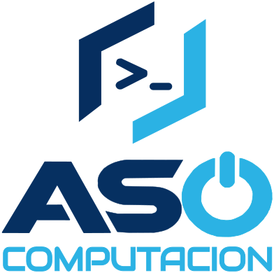
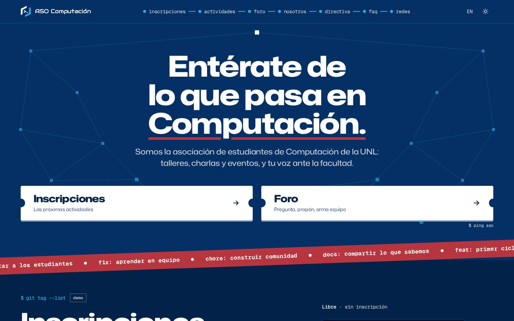
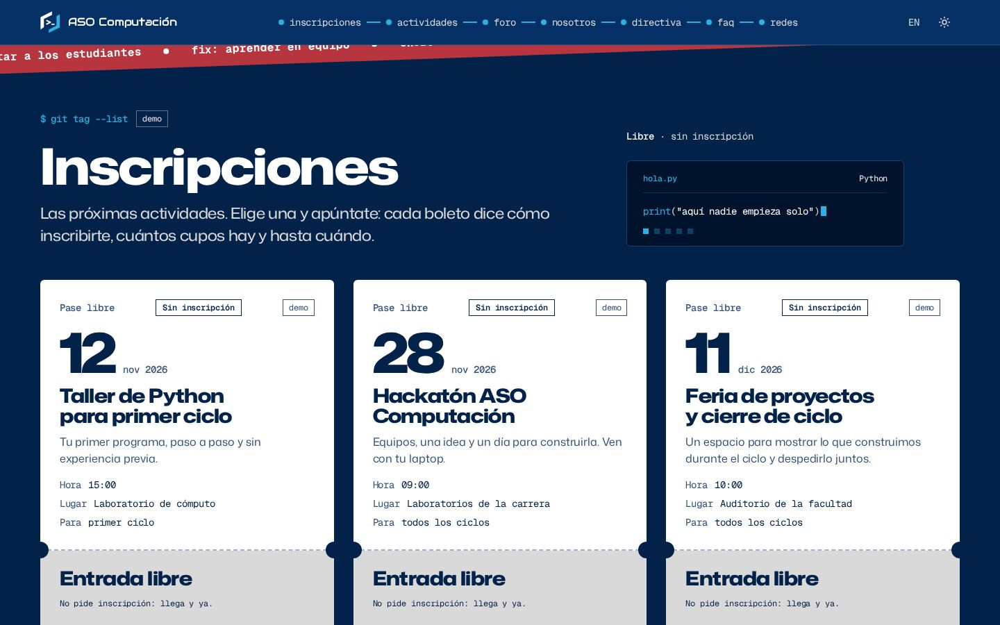
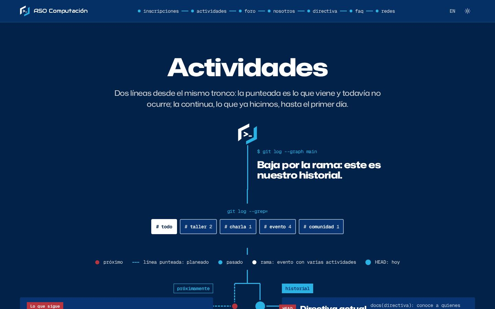
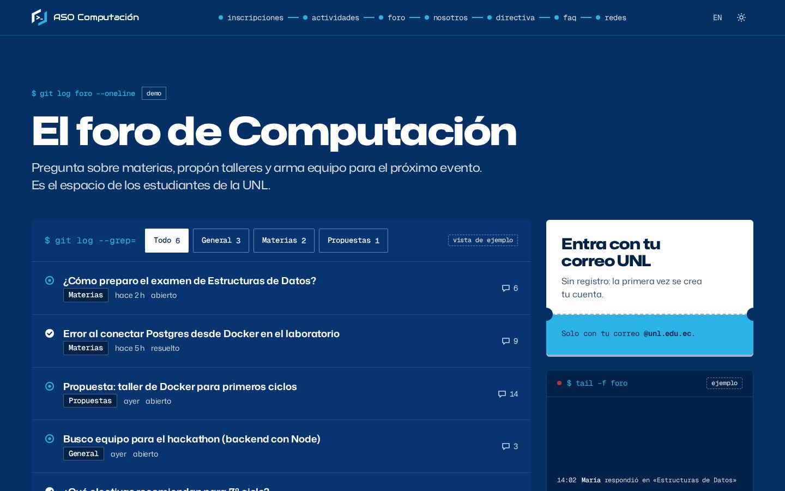
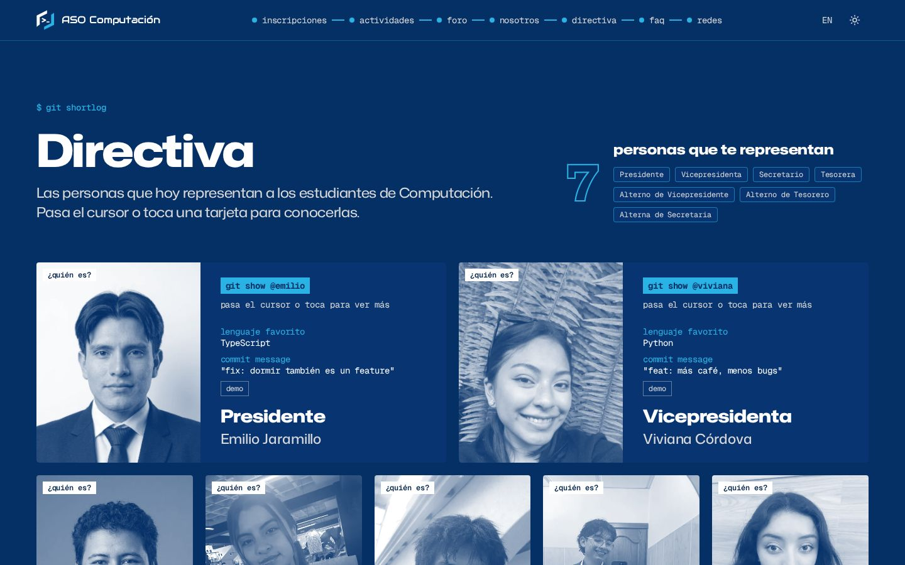
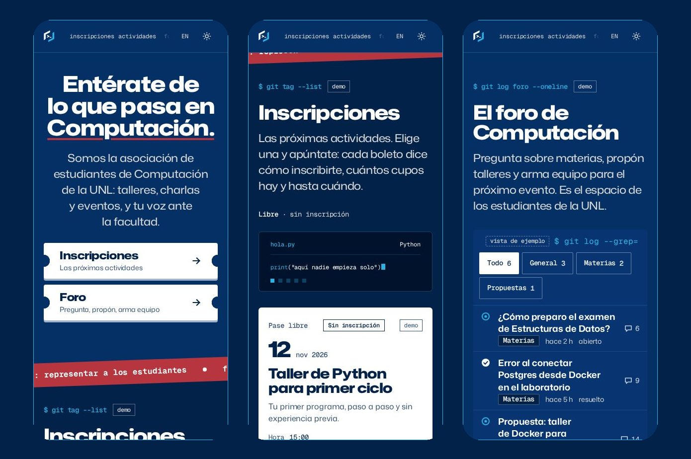
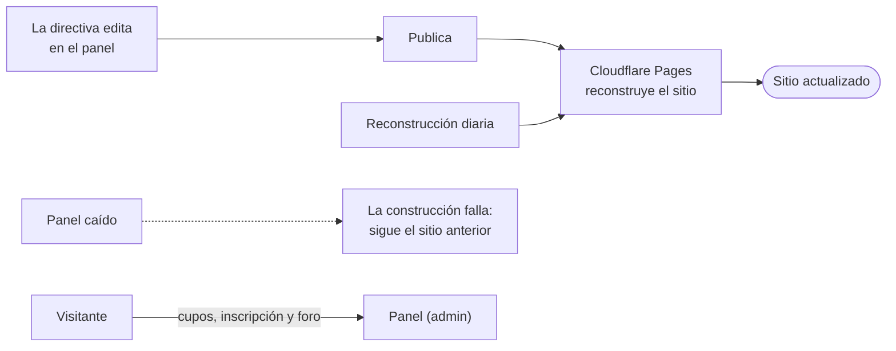

<div align="center">

<picture>
  <source media="(prefers-color-scheme: dark)" srcset="src/assets/brand/logo-white-sky.svg">
  
</picture>

# ASO Computación · Sitio web

Sitio de la Asociación de Estudiantes de la carrera de Computación de la Universidad Nacional de Loja.

[](https://github.com/aso-computacion-unl/aso-computacion-landing/actions/workflows/ci.yml)
[](LICENSE)

### 🌐 [aso-computacion-landing.pages.dev](https://aso-computacion-landing.pages.dev)



</div>

## Qué es

El sitio donde los estudiantes de Computación se enteran de lo que pasa en la carrera y hacen lo que vinieron a hacer. La página va en este orden: quiénes somos, **inscripciones** a las próximas actividades (un boleto por actividad, con los cupos que quedan en vivo), las **actividades** como una línea de tiempo al estilo de un historial de git, las **novedades**, una puerta al **foro** de estudiantes, la **directiva** vigente, preguntas frecuentes, cómo aportar ideas, redes y aliados. Tiene modo oscuro y claro, y está en español (`/`) y en inglés (`/en/`); el contenido cargado en el admin no se traduce (ver [docs/REFERENCIA.md](docs/REFERENCIA.md#themes-and-languages)).

La inscripción y el foro **no viven aquí**: el sitio muestra los boletos y enlaza a la página del evento (`/foro/eventos/<slug>`) y al foro (`/foro`) en el panel de administración, que es quien guarda las inscripciones y las cuentas. El sitio no envía ni guarda nada de lo que escribe una persona.

<table>
  <tr>
    <td width="50%"><br><sub><b>Inscripciones:</b> un boleto por actividad, con sus cupos.</sub></td>
    <td width="50%"><br><sub><b>Actividades:</b> lo que viene y su historia.</sub></td>
  </tr>
  <tr>
    <td width="50%"><br><sub><b>Foro:</b> la puerta al foro de estudiantes.</sub></td>
    <td width="50%"><br><sub><b>Directiva:</b> quiénes representan a los estudiantes.</sub></td>
  </tr>
</table>

<div align="center">
  
  <br><sub>Pensado también para el teléfono.</sub>
</div>

## Cómo se actualiza

El contenido no vive en este repositorio: la directiva lo edita desde un panel de administración, sin tocar código. El sitio es estático y lee ese contenido **al construirse**; al publicar, se reconstruye en segundos, y además se reconstruye una vez al día (para que «hoy» avance y las actividades pasen de próximas a historial). Si el panel no estuviera disponible, la construcción de producción **falla a propósito** y el sitio anterior sigue publicado: nunca se publica contenido de ejemplo. La copia incluida en el repositorio solo se usa en local, en la CI y en las vistas previas.



El panel tiene su propio repositorio: [aso-computacion-admin](https://github.com/aso-computacion-unl/aso-computacion-admin). Cómo encajan el panel y el sitio (flujo de datos, API pública, inscripciones, roles) está en [su documento de arquitectura](https://github.com/aso-computacion-unl/aso-computacion-admin/blob/main/docs/ARQUITECTURA.md).

## Tecnologías

[Astro](https://astro.build) · [Tailwind CSS](https://tailwindcss.com) · [GSAP](https://gsap.com) y [Lenis](https://lenis.darkroom.engineering) (movimiento, cargados solo cuando hacen falta) · [Cloudflare Pages](https://pages.cloudflare.com)

Calidad: TypeScript, Vitest, Playwright con axe-core y Lighthouse CI, ESLint, Prettier y Dependabot; todo corre en la CI (ver [docs/REFERENCIA.md](docs/REFERENCIA.md#quality-gates)).

## Probarlo en local

Requiere Node.js 22.23.4 o superior y [pnpm](https://pnpm.io).

```sh
pnpm install
pnpm dev       # http://localhost:4321
pnpm test      # pruebas unitarias (Vitest)
pnpm lint      # ESLint; pnpm check (tipos) y pnpm format:check completan lo que corre la CI
pnpm build     # genera ./dist
pnpm test:e2e  # Playwright + axe sobre el último build (la primera vez: pnpm exec playwright install chromium)
```

Sin la variable `ADMIN_CONTENT_URL`, el sitio usa la copia del contenido incluida en el repositorio, así que funciona sin configurar nada (con etiquetas «demo» en lo que es de ejemplo). Si levantas `pnpm dev` antes de que el panel responda, el servidor vuelve a preguntarle solo en la siguiente visita. En producción (la rama `main` en Cloudflare Pages) un build que caería a esa copia falla a propósito y el sitio anterior sigue publicado; ver [docs/DEPLOY.md](docs/DEPLOY.md).

Para ver borradores y contenido programado antes de publicarlos hay un build de vista previa (`PREVIEW_BUILD=1` con `PREVIEW_TOKEN` y `ADMIN_PREVIEW_URL`). Muestra la barra «Vista previa — no publicar», no se indexa y se detiene si el código venció; solo se usa en local o en un proyecto aparte protegido. Ver [docs/DEPLOY.md](docs/DEPLOY.md#preview-builds).

## Cómo colaborar

Este es un proyecto de la comunidad y cualquier persona puede aportar con una propuesta de cambio (Pull Request) hacia `main`. Para errores o ideas, abra un issue.

- Guía de contribución: [CONTRIBUTING.md](CONTRIBUTING.md)
- Vulnerabilidades: se reportan en privado, según [SECURITY.md](SECURITY.md)

## Documentación

| Documento | Para qué sirve |
|-----------|----------------|
| [README.md](README.md) | Esta presentación del proyecto |
| [CONTRIBUTING.md](CONTRIBUTING.md) | Flujo de trabajo y convenciones para colaborar |
| [docs/DEPLOY.md](docs/DEPLOY.md) | Publicación en Cloudflare Pages, reconstrucciones automáticas e inscripciones |
| [docs/REFERENCIA.md](docs/REFERENCIA.md) | Referencia técnica: contenido, copia de respaldo, mapeo a la página, pruebas y calidad |
| [Arquitectura del sistema](https://github.com/aso-computacion-unl/aso-computacion-admin/blob/main/docs/ARQUITECTURA.md) | Cómo encajan el panel y este sitio (vive en el repo del panel) |
| [PRODUCT.md](PRODUCT.md) | Qué es el producto, para quién y sus compromisos de marca |
| [SECURITY.md](SECURITY.md) | Cómo reportar una vulnerabilidad |
| [AGENTS.md](AGENTS.md) | Indicaciones para agentes de IA que trabajan en el repositorio |

## Licencia

Publicado bajo la [licencia MIT](LICENSE).
