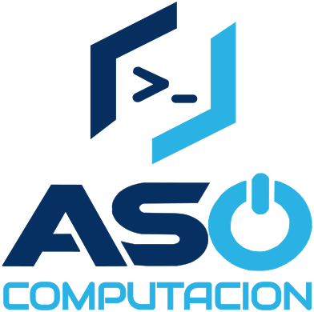
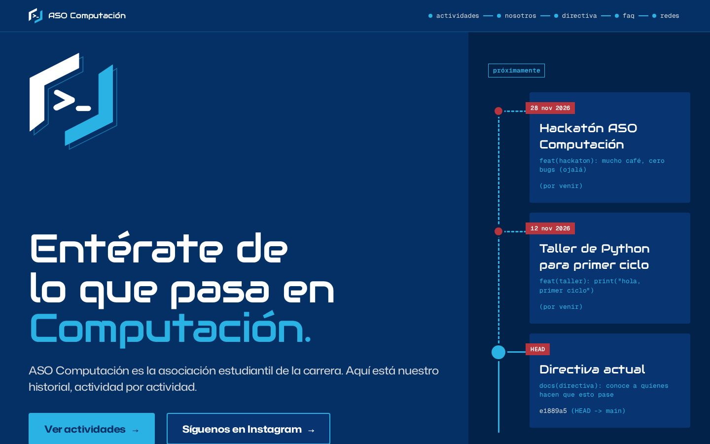
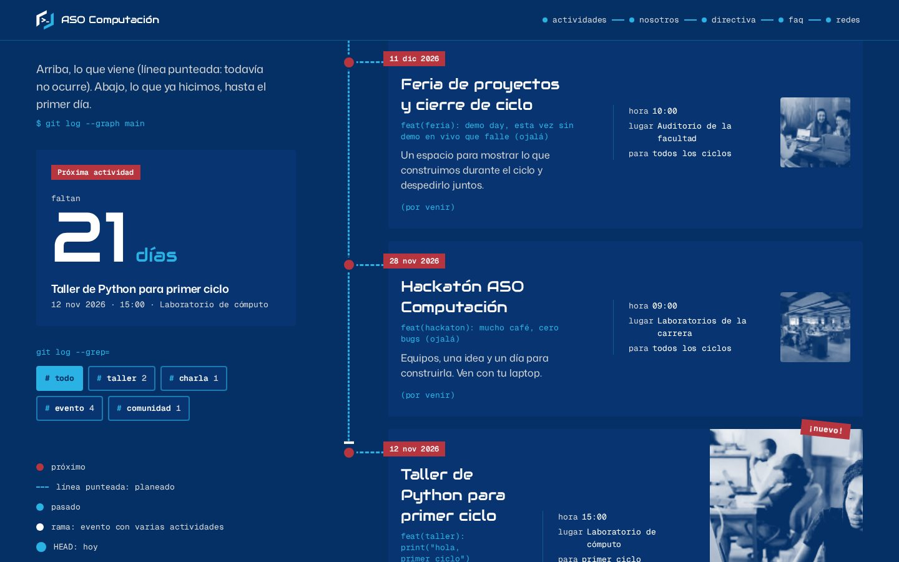
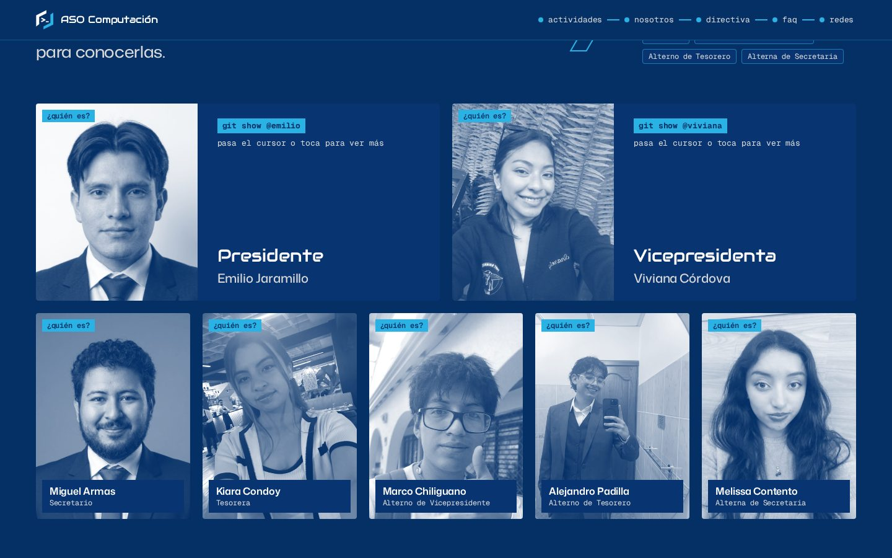
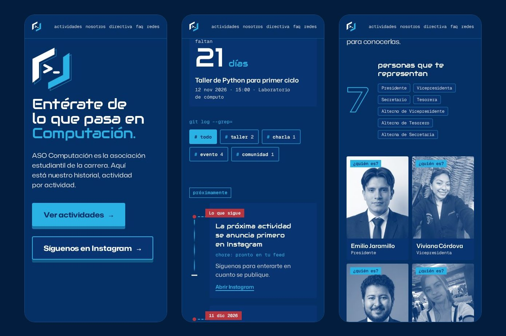
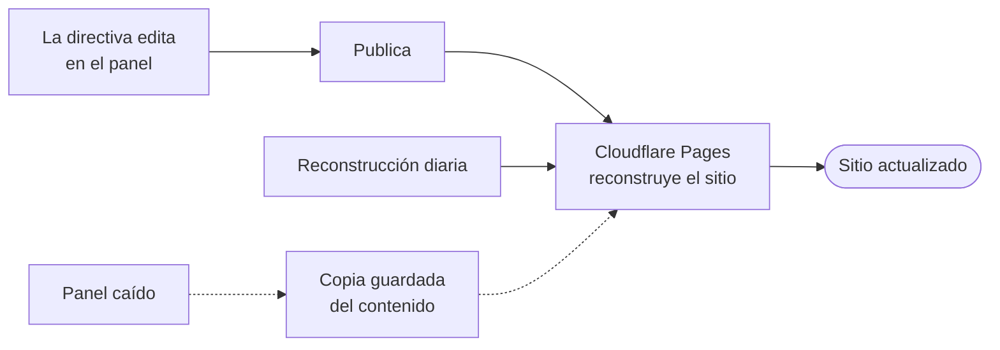

<div align="center">

<picture>
  <source media="(prefers-color-scheme: dark)" srcset="src/assets/brand/logo-white-sky.svg">
  
</picture>

# ASO Computación · Sitio web

Sitio de la Asociación de Estudiantes de la carrera de Computación de la Universidad Nacional de Loja.

[](https://github.com/aso-computacion-unl/aso-computacion-landing/actions/workflows/ci.yml)
[](LICENSE)

### 🌐 [aso-computacion-landing.pages.dev](https://aso-computacion-landing.pages.dev)



</div>

## Qué es

El sitio donde los estudiantes de Computación se enteran de lo que pasa en la carrera. Presenta el historial de actividades como una línea de tiempo al estilo de un historial de git, publica novedades, muestra a la directiva vigente y explica cómo sumarse a la asociación. Tiene modo oscuro y claro, y está en español (`/`) y en inglés (`/en/`); el contenido cargado en el admin no se traduce (ver [docs/REFERENCIA.md](docs/REFERENCIA.md#themes-and-languages)).

<table>
  <tr>
    <td width="50%"><br><sub><b>Actividades:</b> próximos eventos y su historia.</sub></td>
    <td width="50%"><br><sub><b>Directiva:</b> quiénes representan a los estudiantes.</sub></td>
  </tr>
</table>

<div align="center">
  
  <br><sub>Pensado también para el teléfono.</sub>
</div>

## Cómo se actualiza

El contenido no vive en este repositorio: la directiva lo edita desde un panel de administración, sin tocar código. Al publicar, el sitio se reconstruye en segundos, y además se reconstruye una vez al día. Si el panel no estuviera disponible, el sitio sigue funcionando con la última copia guardada del contenido.



El panel tiene su propio repositorio: [aso-computacion-admin](https://github.com/aso-computacion-unl/aso-computacion-admin).

## Tecnologías

[Astro](https://astro.build) · [Tailwind CSS](https://tailwindcss.com) · [GSAP](https://gsap.com) · [Cloudflare Pages](https://pages.cloudflare.com)

## Probarlo en local

Requiere Node.js 22.23.4 o superior y [pnpm](https://pnpm.io).

```sh
pnpm install
pnpm dev      # http://localhost:4321
pnpm test     # pruebas
pnpm lint     # ESLint; pnpm check (tipos) y pnpm format:check completan lo que corre la CI
pnpm build    # genera ./dist
```

Sin la variable `ADMIN_CONTENT_URL`, el sitio usa la copia del contenido incluida en el repositorio, así que funciona sin configurar nada.

## Cómo colaborar

Este es un proyecto de la comunidad y cualquier persona puede aportar con una propuesta de cambio (Pull Request) hacia `main`. Para errores o ideas, abre un issue.

- Guía de contribución: [CONTRIBUTING.md](CONTRIBUTING.md)
- Vulnerabilidades: se reportan en privado, según [SECURITY.md](SECURITY.md)

## Documentación

| Documento | Para qué sirve |
|-----------|----------------|
| [README.md](README.md) | Esta presentación del proyecto |
| [CONTRIBUTING.md](CONTRIBUTING.md) | Flujo de trabajo y convenciones para colaborar |
| [docs/DEPLOY.md](docs/DEPLOY.md) | Publicación en Cloudflare Pages y reconstrucciones automáticas |
| [docs/REFERENCIA.md](docs/REFERENCIA.md) | Referencia técnica: contenido, copia de respaldo y mapeo a la página |
| [SECURITY.md](SECURITY.md) | Cómo reportar una vulnerabilidad |

## Licencia

Publicado bajo la [licencia MIT](LICENSE).
